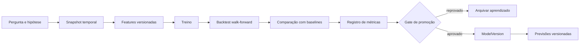

# Arquitetura de dados, análises e previsões

Decisão vigente de 27/10/2026: API e análises usam conjuntos de revisões aprovados, por loteria, conforme [contratos do produto](contratos-produto.md) e [modelo complementar](../database/modelo-logico.md#8-módulos-do-produto-para-a-primeira-versão). Resultados, datasets e previsões são privados. As seis modalidades precisam de métodos compatíveis com seus componentes/regras; o protótipo Mega-Sena não é implementação universal.

## Camadas de dados

| Camada | Conteúdo | Mutabilidade | Autoridade |
|---|---|---|---|
| Raw | resposta original, headers e hash | imutável | evidência da fonte |
| Normalizada | concursos, revisões, números, faixas e dinheiro | revisões append-only | registro operacional |
| Analítica | snapshots, features e agregações | recriável e versionada | entrada de análises |
| Experimentos | configurações, métricas e artefatos | append-only | evidência científica |
| Serving | estatísticas e previsões publicadas | substituível por versão | leitura otimizada |

## PostgreSQL

O banco transacional deverá armazenar:

- catálogo publicado e suas versões;
- execuções de ingestão e metadados dos artefatos;
- concursos e revisões;
- faixas, valores e diagnósticos;
- usuários, sessões, papéis e auditoria;
- jobs, outbox e estado operacional;
- metadados de datasets, análises, experimentos e previsões.

Arquivos brutos, modelos grandes e exports ficam fora do banco, referenciados por URI e hash.

## Consistência

- Identidade interna é opaca; referências oficiais permanecem com namespace.
- Constraints devem impedir sobreposição de regras validadas.
- Revisões publicadas não são atualizadas no lugar.
- Publicação, outbox e auditoria acontecem na mesma transação.
- Para a primeira consulta por conjuntos, aprovação/troca do ativo/auditoria/job derivado são transacionais; não dependem de ligar `published_revision_id` ou remover o gate de publicação individual.
- Remoção administrativa usa arquivamento; evidência e auditoria não são apagadas por fluxo comum.
- Dinheiro usa decimal; nunca ponto flutuante.

## Datasets analíticos

Cada snapshot deve registrar:

- loterias e concursos incluídos;
- regra temporal aplicável;
- revisão exata de cada concurso;
- instante de corte;
- transformação e versão do código;
- hash do manifesto e localização;
- diagnósticos e exclusões justificadas.

Features nunca podem usar informação publicada depois do instante que está sendo previsto.

## Ciclo de um experimento

## Baselines obrigatórios

- seleção uniforme aleatória;
- amostragem aleatória com a mesma quantidade de apostas;
- frequência histórica simples;
- janela móvel de frequência;
- heurísticas de atraso, quando aplicáveis;
- modelo atualmente publicado.

O objetivo é prever da melhor forma possível. Um método novo só é considerado avanço quando supera referências adequadas fora da amostra e o resultado é reproduzível.

## Métricas

Não haverá uma única “acurácia”. Conforme o problema:

- log loss ou Brier score para probabilidades calibradas;
- cobertura e calibração;
- quantidade média de acertos por combinação;
- distribuição de acertos e intervalos de confiança;
- lift contra baseline sob o mesmo orçamento de apostas;
- estabilidade por período e versão de regra;
- custo computacional e latência.

Retorno financeiro só pode ser exibido com regras de prêmio, custo, jurisdição e período corretamente versionados.

## Promoção e publicação

- Experimento e modelo são objetos diferentes.
- Aprovação automática exige limiares predefinidos; caso contrário, revisão humana.
- Modelo publicado é imutável e possui versão.
- Toda previsão guarda modelo, snapshot, horário de geração e horizonte.
- Resultados são avaliados posteriormente sem alterar a previsão original.
- Interface diferencia claramente exploração, backtest e previsão realmente emitida antes do sorteio.

## Código legado de análise

`app/analysis/pipeline.py` gera combinações sequenciais e probabilidades sem calibração, usa divisão aleatória e não representa as seis matrizes. Seus resultados não devem ser publicados nem usados como baseline científico. Ele será substituído por pequenos fluxos testados, sem remoção nesta SPEC.
