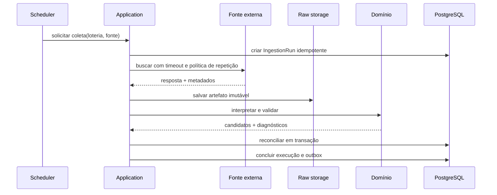

# Módulos e fronteiras

Consolidação de 27/10/2026: aplicar o [contrato privado das seis loterias](contratos-produto.md). Scheduler é o disparador Actions; estado durável fica no banco. A primeira versão lê conjuntos aprovados e não exige implementar todo o fluxo futuro de publicação individual abaixo.

## Mapa de módulos

| Módulo | Responsabilidade | Conceitos principais |
|---|---|---|
| Catálogo | modalidades, regras, mercados, agendas e fontes | Lottery, RuleVersion, DataSource |
| Ingestão | adquirir, preservar, interpretar e reconciliar | IngestionRun, RawArtifact, Candidate |
| Concursos | manter identidade, revisões e publicação | Draw, DrawRevision, PrizeTierResult |
| Analytics | datasets e estatísticas descritivas | DatasetSnapshot, AnalysisRun, Metric |
| Forecasting | experimentos, modelos e previsões | Experiment, ModelVersion, Forecast |
| Identity | conta, credencial, sessão e recuperação | User, Identity, Session |
| Administração | aprovação e operação autorizada | ChangeRequest, Approval, AuditEvent |
| Notificações | alertas operacionais e comunicações | Notification, DeliveryAttempt |

## Regras entre módulos

- Ingestão consulta o catálogo, mas catálogo não conhece ingestão.
- Concursos recebe candidatos aceitos; não conhece HTTP nem formato XLSX/HTML/JSON.
- Analytics lê somente conjuntos/snapshots aprovados, com membros e versão explícitos; publicação individual é evolução posterior.
- Forecasting depende de snapshots analíticos, nunca das tabelas raw diretamente.
- API chama casos de uso; não chama repositórios de outro módulo.
- Administração orquestra mudanças, mas invariantes permanecem no módulo proprietário.
- Identity fornece sujeito e papéis; cada caso de uso decide a permissão necessária.

## Fluxo de coleta



Com receipt confirmado, uma falha de interpretação pode ser retomada sem novo download. PUT sem receipt pode deixar objeto órfão: bytes sozinhos não comprovam status/instante HTTP, portanto não se fabrica a captura perdida. A chave de comando identifica a intenção de aquisição/processamento; hash raw deduplica bytes, não capturas. Detalhes implementados na [SPEC-0025](../specs/SPEC-0025-persistencia-transacional-mega-sena.md).

O diagrama é a arquitetura-alvo: o recorte PostgreSQL da SPEC-0025 ainda não inclui outbox/publicação nem scheduler, e convive com o fluxo legado em arquivos.

## Fluxo de publicação de concurso

1. A ingestão cria uma revisão candidata.
2. Validações estruturais e de regra produzem diagnósticos.
3. Candidato inválido vai para quarentena; nunca substitui o publicado.
4. Candidato idêntico é reconhecido como repetição idempotente.
5. Candidato diferente para o mesmo concurso cria nova revisão.
6. Política automática ou aprovação humana promove a revisão.
7. Um evento de outbox invalida caches e dispara análises derivadas.

## Fluxo administrativo

Toda alteração sensível segue:

```text
comando autenticado
  → autorização no caso de uso
  → validação do domínio
  → transação
  → AuditEvent imutável
  → resposta sem dados sensíveis
```

Ativação de loteria ou fonte exige aprovação explícita. Alteração de regra vigente nunca reescreve resultados históricos.

## Contratos HTTP privados

- API usa `/api/v1` e objetos de resposta próprios; entidades de domínio e ORM não são serializadas diretamente.
- Todo conteúdo requer sessão e aprovação atuais; apenas entrada/callback e estado da própria solicitação têm exceções limitadas, conforme segurança.
- Erros têm código estável, mensagem segura e `correlation_id`.
- Paginação é por cursor para séries grandes.
- Datas civis e instantes são tipos distintos.
- Dinheiro usa string decimal e código ISO 4217.
- Mudança incompatível exige nova versão ou período de depreciação.

## Testes de arquitetura futuros

- domínio não importa FastAPI, SQLAlchemy, requests, pandas ou módulos de UI;
- módulos não acessam tabelas/repositórios privados de outro módulo;
- interfaces não contêm regras de negócio;
- normalizadores não escrevem arquivos ou banco;
- casos de uso não dependem do relógio real ou rede sem porta injetada.
