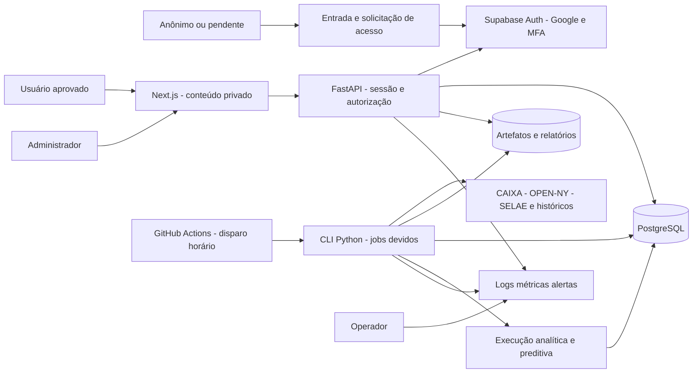

# Arquitetura de referência do LottoBrain

## Decisão vigente e encerramento da etapa 3

Consolidada em 27/10/2026 após o encerramento da etapa 2. **Etapa 3 concluída no escopo de arquitetura**, com suporte obrigatório a Mega-Sena, Lotofácil, +Milionária, Powerball, Mega Millions e EuroMillions. Implementação, testes operacionais, provisionamento e publicação continuam nas entregas 0033–0036; não foram realizados por esta consolidação.

As decisões de acesso e atualização desta revisão substituem as anteriores: todo conteúdo do produto é privado, cadastro depende de aprovação do proprietário, primeira tentativa em torno de uma hora após o sorteio e reconciliação no dia seguinte. A escolha inicial de implantação é Vercel + Supabase + GitHub Actions, a custo inicial zero, com as condições operacionais descritas no documento de infraestrutura. [ADR-0004](decisions/ADR-0004-produto-privado-seis-loterias.md) registra os motivos e limites. A SPEC-0019 permanece concluída em seu escopo original, agora complementado.

| Assunto | Referência principal |
|---|---|
| Componentes e dependências | Este documento e [módulos](modulos-e-fronteiras.md) |
| APIs, frontend e fluxos de aplicação | [Contratos do produto](contratos-produto.md) |
| Dados/revisões e módulos novos | [Modelo lógico](../database/modelo-logico.md), seção 8 |
| Identidade, aprovação e privacidade | [Segurança](seguranca-e-requisitos.md) |
| Agendamento, ambientes, CI/CD e recuperação | [Infraestrutura](entrega-e-infraestrutura.md) |
| Estatísticas, modelos e avaliação temporal | [Dados, análises e previsões](dados-analises-previsoes.md) |
| Fontes escolhidas e disponibilidade dos campos | [Etapa 2 encerrada](../data/encerramento-etapa-2.md) |

## Princípios

1. Clareza antes de abstração.
2. Uma única autoridade para cada conceito.
3. Raw imutável e toda transformação rastreável.
4. Domínio independente de banco, framework e interface.
5. Módulos comunicam-se por casos de uso e contratos explícitos.
6. Falha externa não corrompe estado interno.
7. Segurança, auditoria e observabilidade fazem parte do desenho.
8. Previsões devem ser reproduzíveis, comparáveis e temporalmente válidas.
9. Complexidade é adicionada somente quando resolve um problema observado.

## Contexto



## Contêineres lógicos

| Componente | Responsabilidade | Não deve fazer |
|---|---|---|
| Web | experiência, visualização, formulários e acessibilidade | consultar banco ou fonte de loteria diretamente |
| API | autenticar, autorizar e executar casos de uso síncronos | conter scraping, treinamento ou SQL espalhado |
| Worker | coleta, normalização, reconciliação e experimentos assíncronos | decidir permissões de interface ou renderizar páginas |
| Scheduler | criar execuções no momento esperado | implementar regra de loteria ou chamar parser diretamente |
| PostgreSQL | registro transacional, identidade, revisões e auditoria | armazenar arquivos brutos grandes como blobs por padrão |
| Artifact storage | raw imutável, exports e artefatos de modelo | ser a única fonte de metadados pesquisáveis |
| Observabilidade | logs, métricas, traces e alertas | receber segredos ou conteúdo sensível desnecessário |

API e worker usam o mesmo código modular inicialmente. São processos diferentes para isolar carga e ciclo de vida, não microsserviços.

O navegador usa uma origem: `/api/v1` é encaminhado pelo frontend à API. Somente endpoints de início/callback da autenticação e a estrutura sem dados da tela de entrada são acessíveis sem aprovação. API e arquivos privados continuam protegidos mesmo por acesso direto. Autenticação por si só não autoriza leitura. O scheduler é um disparador; PostgreSQL conserva a autoridade sobre jobs, leases, aprovações e conjuntos de dados ativos.

## Direção de dependências

```text
interfaces (HTTP, CLI, jobs)
            ↓
application (casos de uso e portas)
            ↓
domain (regras e invariantes)
            ↑
infrastructure (PostgreSQL, HTTP, storage, e-mail)
```

- `domain` depende apenas da biblioteca padrão e de módulos internos de domínio.
- `application` depende do domínio e declara portas para persistência, relógio, filas e fontes.
- `infrastructure` implementa portas; não é importada pelo domínio.
- `interfaces` traduz transporte em comandos/consultas e não contém regra de negócio.

## Estrutura inicial de implementação

```text
app/
  domain/            # regras, catálogo e invariantes compartilhadas
  application/       # ingestão, consulta, acesso, análises e administração
  ingestion/         # normalizadores e perfis por contrato de fonte
  infrastructure/    # PostgreSQL, HTTP, Auth e storage
  interfaces/        # API, CLI e entrada dos jobs
frontend/
  src/
    app/
    features/
    components/
    design-system/
    services/
infra/
tests/
docs/
data/                 # somente desenvolvimento; produção usa storage externo
```

Preservar `app/` e as importações existentes; não introduzir `backend/` ou uma segunda implementação das mesmas regras só por organização visual. Os módulos do mapa são responsabilidades lógicas, organizadas em arquivos/pacotes quando a capacidade for implementada. A criação do frontend é separada; o protótipo Flask não serve como API de produção.

## Stack de referência

| Área | Direção inicial | Motivo |
|---|---|---|
| Backend | Python 3.12, FastAPI, Pydantic | núcleo Python existente, contratos HTTP tipados e OpenAPI |
| Persistência | PostgreSQL, SQLAlchemy 2, Alembic | transações, constraints e migrações explícitas |
| Jobs | CLI Python, jobs duráveis no PostgreSQL, Actions como disparador | retomada sem processo permanente ou fila externa |
| Frontend | React/Next.js com TypeScript | composição de dashboard, SSR quando útil e ecossistema de gráficos |
| UI | design tokens e componentes acessíveis | consistência sem framework visual acoplado ao domínio |
| Identidade | Supabase Auth com Google OAuth/PKCE e MFA administrativo | autenticação gerenciada, cadastro interno pendente e recuperação no provedor |
| Artefatos | Supabase Storage privado através de uma porta | raw imutável, nenhuma URL pública de dados |
| Testes | pytest no código novo; Playwright na interface | boa ergonomia, integração e E2E |
| Implantação | Next.js e uma função FastAPI na Vercel; CLI no Actions | backend modular preservado; processamento pesado fora do request |
| CI/CD | GitHub Actions | verificação automatizada e promoção controlada |

Versões exatas de novas dependências e lockfiles serão fixados junto do primeiro build reproduzível da SPEC-0033, sem uma SPEC adicional de escolha de bibliotecas. As dependências Python existentes são preservadas nesta etapa. OCI continua uma opção de empacotamento futura, sem requisito de executar containers de produção na Vercel.

## Leitura segura de resultados

A primeira versão utiliza **conjuntos de revisões aprovados**, por loteria, com manifesto imutável e ponteiro de conjunto ativo. API e análises leem seus membros exatos. A baseline e a política de promoção são aprovadas pelo administrador. Depois disso, acréscimos elegíveis podem ser aprovados automaticamente pela política versionada, sem aprovação humana a cada sorteio. Candidatos, maior concurso observado e revisão mais recente não entram apenas por existirem. Conflitos/correções não autorizados pela política aguardam decisão; toda troca exige validação, autorização e transação.

Esse caminho não usa nem remove a constraint atual `publication_not_implemented`, nem escreve em `published_revision_id`. A publicação individual com decisões/outbox continua uma evolução distinta. [Persistência complementar](../database/modelo-logico.md#8-módulos-do-produto-para-a-primeira-versão) define a decisão de leitura sem confundi-la com autorização do usuário.

## Cobertura das seis loterias

| Perfil | Identidade/componentes | Integração planejada |
|---|---|---|
| Mega-Sena | número oficial; 6/60 | Reusar fluxo transacional, leitores e ponte XLSX/JSON existentes; adaptar o título atual |
| Lotofácil | número oficial; 15/25 | Mesmo caso de uso por perfil; manter concursos oficiais distintos na mesma data |
| +Milionária | número oficial; 6/50 + dois trevos | Componentes e dez faixas separados; não adaptar como Mega-Sena com oito bolas |
| Powerball | identidade qualificada por fonte/data/série; matriz vigente | Histórico existente + OPEN-NY recente; Double Play mantém série e cobertura independentes |
| Mega Millions | identidade qualificada por fonte/data; matriz vigente | Histórico existente + OPEN-NY; multiplicador sorteado antigo separado do fator do bilhete |
| EuroMillions | data canônica e referência externa; cinco números + estrelas por vigência | SELAE por data e FDJ histórico; categorias por acertos, dinheiro e território preservados |

Uma API e um contrato de consulta atendem os seis perfis. Adaptadores resolvem origem/formato; regras vêm do catálogo versionado. A implementação não usa tabela por loteria nem seis cópias do backend. O cadastro futuro cria rascunho; ativação depende de perfil suportado e validado. Fluxos SQL adicionais ainda precisam ser implementados: o desenho completo não é prova de funcionamento das seis.

## Aceite da etapa 3

| Critério | Resultado arquitetural |
|---|---|
| Fronteiras e dependências | Módulos e portas definidos; layout existente preservado |
| Frontend e backend | Origem única, contratos de consulta/comando e estados de tela definidos |
| Banco e leitura | Modelo de identidade, jobs, conjuntos aprovados e experimentos ligado às revisões existentes |
| Privacidade | Login, pendência, aprovação, revogação e MFA definidos; conteúdo sempre privado |
| Atualização | Política de +1h e reconciliação D+1 por calendário/fuso, com atraso visível |
| Seis modalidades | Matriz de perfis e critérios cumulativos das SPECs 0033–0036 |
| Infraestrutura | Serviços, unidades, ambientes, segredos, recuperação e limites documentados |
| Entrega | Etapa 4 prepara a experiência visual; implementação segue os contratos nas SPECs funcionais |

Concluir este aceite significa desenho pronto para implementação. A aceitação de produção exige fluxos reais, serviços provisionados, testes e recuperação demonstrados nas respectivas entregas.

Verificação da consolidação original: 18 documentos e 126 links locais/âncoras conferidos, sem referência quebrada ou problema de formatação detectado; inspeção estática dos seis módulos Python do domínio sem imports das camadas/frameworks proibidos. Dos 334 arquivos existentes naquele início, somente 16 documentos foram alterados e dois documentos arquiteturais acrescentados. Código, migrations, dependências, dados brutos, amostras, relatórios anteriores e testes permaneceram idênticos por SHA-256. A suíte de 98 testes de fontes já aprovada não foi reexecutada para uma alteração documental; APIs, sessões e serviços novos ainda exigem seus testes de implementação.

### Auditoria de fechamento em 27/10/2026

Revisão de comportamento e coerência entre os documentos, além da validação de links. Quatro lacunas de contrato foram encontradas e corrigidas nesta auditoria:

| Ponto | Fechamento arquitetural |
|---|---|
| Vínculo e revogação de acesso | Cookie transitório liga OAuth ao navegador; consumo de tentativa é atômico; comandos administrativos revalidam autorização na transação. Referência: [segurança](seguranca-e-requisitos.md) |
| Unicidade dos jobs | Chave canônica não nula e única, escopo global explícito, hash de parâmetros e locks compartilhados entre modos. Referência: [modelo lógico](../database/modelo-logico.md#8-módulos-do-produto-para-a-primeira-versão) |
| Consistência do backup | Dump e manifesto usam o mesmo snapshot; objetos são verificados antes de concluir; último backup completo é preservado. Referência: [infraestrutura](entrega-e-infraestrutura.md) |
| Qualidade e correções | Atualidade e qualidade são dimensões distintas; revisão pendente aparece com aviso e suspende previsões/promoções afetadas; imutabilidade é preservada. Referência: [contratos do produto](contratos-produto.md) |

**Resultado do aceite arquitetural: concluído, sem pendência essencial de desenho identificada após os ajustes.** Critérios acima cobrem privacidade, seis perfis, leitura aprovada, frontend/backend/banco, processamento, infraestrutura e recuperação. Google/OAuth configurado, migrations complementares, execução dos seis perfis, cota real, jobs, testes de acesso/restauração e deploy permanecem aceites de implementação/operação nas SPECs 0033–0036, não decisões de arquitetura sem responsável. Design visual detalhado pertence à etapa 4.

Esse resultado é limitado à documentação e à inspeção estática realizadas; não é garantia de ausência de defeitos futuros ou certificado de que o produto já opera. A etapa 4 pode usar esses contratos sem nova rodada de arquitetura.

## Estado atual versus alvo

| Área atual | Classificação | Tratamento |
|---|---|---|
| `app/domain` | fundação oficial | evoluir mantendo independência |
| `app/ingestion` | fundação oficial | envolver em casos de uso e portas |
| `app/catalog.py` | catálogo inicial | migrar sem duplicar definições |
| `app/core/config.py` | legado | não ampliar; contém calendários desatualizados |
| `app/core/downloader.py` | legado | substituir por adaptadores HTTP testáveis e seguros |
| `app/analysis/pipeline.py` | protótipo inválido para previsão | não publicar resultados; substituir por framework de experimentos |
| `app/web/app.py` | protótipo visual | não evoluir como arquitetura final |
| `Procfile` e `vercel.json` | implantação legada | substituir após definição do primeiro ambiente alvo |

## Decisão de escala

O sistema começa como monólito modular porque equipe, volume e tráfego ainda não justificam distribuição. Um módulo só poderá virar serviço quando houver evidência de pelo menos um destes fatores:

- necessidade de escala ou disponibilidade independente;
- isolamento de segurança;
- cadência de implantação incompatível;
- carga computacional que prejudique o restante;
- ownership realmente independente.

Até lá, processos separados e filas internas fornecem isolamento suficiente com menor custo operacional.
