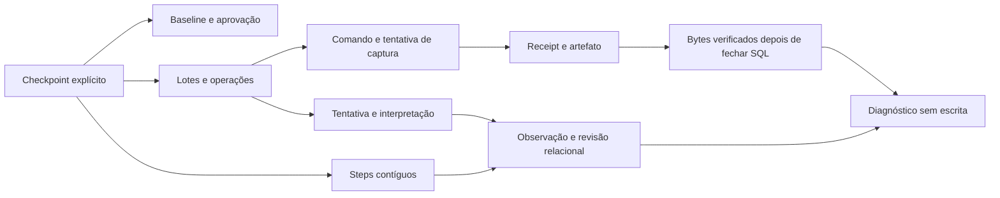

# Contrato de leitura da sincronização — SPEC-0032

A auditoria não acrescenta tabelas nem modifica o contrato de escrita. `PgSyncAuditReader` lê as relações existentes sob REPEATABLE READ READ ONLY, com conexão própria e curta, sem locks de linha/advisory e sem passar pela UoW do ingestor.

O caso de uso recebe um snapshot de valores, não uma sessão SQL ou repositório mutável. O mesmo instante de transação orienta a classificação de lease/cooldown. Todos os SELECTs pertencem ao mesmo snapshot, incluindo reconstrução relacional. Uma escrita concorrente pode aparecer somente na auditoria seguinte; o leitor não impede o escritor.

O resumo terminal é comparado com operações imutáveis daquele lote. A auditoria não compara seu cursor final ao cursor vivo de uma execução posterior, nem exige que tokens antigos continuem atuais. O testemunho do COMMIT pertence ao writer e às constraints; o auditor verifica o registro persistido e seus vínculos, sem alegar reconstruir a validade da lease em cada instante passado.

O hash de aprovação prova a integridade do relatório referenciado, não a cobertura relacional histórica atual inteira. A referência da baseline/artefato é verificada e os bytes históricos são lidos por hash; revalidar todos os 2.954 registros permanece uma operação de cobertura histórica separada.

Limites de seleção e de tentativas são explícitos. Truncamento é retornado e impede status healthy; consultas de diagnóstico não viram uma varredura irrestrita do banco ou storage. Alterações concorrentes nos objetos após o snapshot SQL podem causar evidência ausente/divergente, sem reclassificação silenciosa como sucesso. Não há gravação de relatório no banco.

O login audit já possui SELECT nas tabelas necessárias. Não recebe DML, DDL, bootstrap ou execução de funções do writer. Mesmo com uma conexão de teste privilegiada, READ ONLY recusa DML. DSN, URLs/configurações arbitrárias, nomes de objetos e payloads diagnósticos internos não são devolvidos no relatório público.

[Uso, limites, estados e testes](../engineering/auditoria-sincronizacao-sql-mega-sena.md) e [ledger auditado](lotes-sincronizacao.md).
