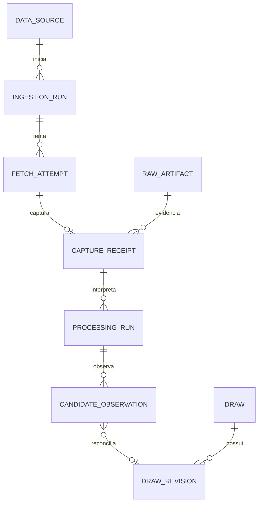

# Modelo lógico de persistência — LottoBrain

## Papel e limites

Esta é a referência lógica da SPEC-0023, detalhando o [modelo canônico](../data/modelo-canonico.md). Os nomes abaixo são relações lógicas; a ordem das migrations e o DDL serão definidos na SPEC-0024. Não existe banco provisionado por esta tarefa.

O desenho cobre catálogo, ingestão, concursos, finanças e continuidade. Contas, sessões, experimentos e infraestrutura mantêm suas fronteiras arquiteturais, com esquema próprio em tarefas futuras. Eles não serão antecipados como tabelas vazias no primeiro incremento.

Evolução posterior: a [SPEC-0024](../specs/SPEC-0024-migrations-integridade.md) implementa o recorte físico de catálogo/evidência/resultados/continuidade; [migrations e operação](migrations-ingestao.md) e [cobertura executada](verificacao-spec-0024.md). A ausência de banco mencionada acima refere-se à entrega documental da SPEC-0023, não à etapa posterior.

O módulo Catálogo é proprietário das definições da seção 1; Ingestão possui aquisição, interpretação, baseline, checkpoint e auditoria de ingestão; Concursos possui identidades, revisões, resultados e decisões de publicação. Auditoria administrativa e outbox são infraestrutura transversal acessada por portas. A escolha de schemas SQL físicos fica para a migration, sem autorizar escrita direta de um módulo nas tabelas de outro.

## Convenções

| Conceito | Decisão |
|---|---|
| Identidade interna | UUID gerado pela aplicação; identificador externo nunca é PK interna |
| Nomes | snake_case, singular; tabelas e campos em inglês, documentação em português |
| Chaves naturais | UNIQUE explícito além da PK; escopo por loteria/fonte conforme o conceito |
| Data de sorteio | `date`, separada do instante e do timezone |
| Instantes | `timestamptz`; conservar também timezone IANA quando pertinente |
| Vigência | início inclusivo, fim exclusivo; fim ausente representa intervalo aberto |
| Dinheiro | `numeric` exato com validação de escala, finitude e envelope; moeda ISO 4217 |
| Hash | SHA-256 hexadecimal minúsculo; identificar algoritmo e versão de canonicalização |
| Estados | texto com CHECK/enums da aplicação; alterações versionadas por migration |
| Exclusão | RESTRICT nas cadeias de evidência; sem cascade que apague histórico de ingestão |
| JSONB | metadados limitados e snapshots de intercâmbio; não substitui entidades, FKs ou dinheiro tipado |

`timestamptz` não preserva o nome do timezone original: o nome IANA será um campo separado quando necessário. [Documentação PostgreSQL 17 — datas e timezones](https://www.postgresql.org/docs/17/datatype-datetime.html).

## 1. Catálogo

Todas as entidades com identidade própria têm `id`. Relações de associação podem usar PK composta.

| Relação | Campos essenciais | Chave e vínculos |
|---|---|---|
| `lottery` | slug, display_name, origin_jurisdiction, status, default_timezone, default_currency, created_at | UNIQUE(slug); defaults são conveniência, não prova sobre um fato financeiro |
| `lottery_scope` | lottery_id, key, kind, jurisdiction_code opcional, label, default_currency opcional | UNIQUE(lottery_id, key); `kind`: common_result, territorial ou provider_context |
| `rule_version` | lottery_id, version_label, valid_from, valid_to, status, evidence_reference, evidence_level | UNIQUE(lottery_id, version_label); sem sobreposição de regras validadas |
| `series_definition` | rule_version_id, key, label, role, required | UNIQUE(rule_version_id, key); exatamente uma principal em regra validada |
| `component_definition` | series_definition_id, key, value_type, min_count, max_count, min_value, max_value, unique_values, order_semantics, position | UNIQUE(series_definition_id, key) e UNIQUE(series_definition_id, position) |
| `prize_tier_definition` | rule_version_id, key, label, criterion_key, criterion_description, position | UNIQUE(rule_version_id, key); critério explicável e testado, sem DSL genérica |
| `data_source` | lottery_id, key, authority, readiness, base_url, data_format, purposes, policy_reference | UNIQUE(lottery_id, key); credenciais só por referência externa |
| `schedule_definition` | lottery_id, scope_id, key, observed_at, valid_from opcional, valid_to opcional, timezone, evidence_reference | UNIQUE(lottery_id, scope_id, key); agenda observada sem início conhecido não vira vigência histórica |
| `schedule_slot` | schedule_definition_id, weekday, event_kind, local_time, approximate | UNIQUE(schedule_definition_id, weekday, event_kind, local_time) |
| `lottery_extension` | lottery_id, key, kind, label, valid_from opcional, valid_to opcional | UNIQUE(lottery_id, key); associação `extension_scope(extension_id, scope_id)` |

`schedule_slot.event_kind` distingue sale_close, draw e expected_publication. A agenda sem vigência confirmada permanece observacional e exige política explícita antes de ativar scheduler. Alterações e exceções de calendário terão contrato próprio; não se infere feriado do ausência de dados.

Os limites de matriz são independentes de preço, calendário e distribuição financeira. `prize_tier_definition` descreve o critério de acerto; não presume que um pagamento fixo atual valha em toda a matriz histórica. Versões comerciais e de política de premiação ficam para tarefa específica; pagamentos observados já cabem como fatos da revisão.

Regra antiga com `valid_to` preenchido continua validada e consultável. Encerrar vigência não deve retirar a regra dos resultados passados. Fechar um intervalo antes aberto exige auditoria e checagem de que nenhuma revisão referenciada fique fora dele.

## 2. Aquisição e interpretação

| Relação | Campos essenciais | Invariantes |
|---|---|---|
| `ingestion_run` | lottery_id, source_id, idempotency_key, request_hash, source_config_snapshot, mode, status, started_at, finished_at, correlation_id | UNIQUE(source_id, idempotency_key); nova coleta intencional usa nova chave; snapshot allowlist sem segredos |
| `fetch_attempt` | run_id, ordinal, requested_identity opcional, url, started_at, finished_at, outcome, http_status opcional, error_code opcional | UNIQUE(run_id, ordinal); falha sem corpo não exige artefato |
| `raw_artifact` | sha256, byte_count, object_key, storage_state, registered_at | UNIQUE(sha256); bytes e tamanho imutáveis; URL e instante da fonte não pertencem ao blob compartilhado |
| `capture_receipt` | source_id, fetch_attempt_id opcional, artifact_id, capture_kind, captured_at, effective_url, http_status opcional, content_type, byte_count | UNIQUE(fetch_attempt_id) quando preenchido; captura HTTP exige tentativa; importação legada admite ausência documentada |
| `processing_run` | receipt_id, adapter_version, code_version, canonicalization_version, validation_policy_version, catalog_fingerprint, status, started_at, finished_at | UNIQUE da receita completa: receipt + versões + fingerprint; mesma interpretação é retomada/reutilizada |
| `processing_attempt` | processing_run_id, ordinal, command_key, request_hash, outcome, started_at, finished_at, error_code opcional | UNIQUE(processing_run_id, ordinal) e UNIQUE(command_key); replay gera nova tentativa, não nova identidade de interpretação |
| `candidate_observation` | processing_run_id, row_locator, lottery_id, draw_id opcional, revision_id opcional, decision, semantic_hash opcional, diagnostic_payload opcional, completed_at | UNIQUE(processing_run_id, row_locator); localização é linha/posição de origem, não número do concurso |
| `validation_issue` | processing_run_id, observation_id opcional, code, severity, field_path, observed_value opcional, expected_value opcional, resolution_reference opcional | observação, se presente, pertence ao mesmo processing_run; conservar problema original ao registrar resolução |

`capture_kind` distingue HTTP de importação de evidência local. Não se inventa tentativa HTTP retroativa para receipts antigos. `captured_at` da captura não é data do sorteio nem hora de treinamento.

`source_config_snapshot` conserva autoridade, prontidão, URL e política usadas na execução, para que uma edição futura de `data_source` não reescreva o contexto da captura. Esse JSON tem schema/versionamento restritos e não contém cookies ou credenciais. Na importação legada, informação reconstruída é identificada como tal; não é apresentada como configuração historicamente capturada.

`candidate_observation.decision`: new, unchanged, correction_candidate, replayed, quarantined ou rejected. Decisões aceitas apontam para uma revisão; dados sem identidade válida permanecem com draw/revision ausentes e diagnóstico rastreável. Linhas duplicadas de um XLSX continuam como observações distintas, mesmo que disputem a mesma identidade.

Um raw pode sustentar muitas capturas. Uma captura pode gerar muitas interpretações, e uma interpretação pode produzir muitas linhas. Esta cardinalidade evita confundir deduplicação de bytes com deduplicação de execução.

## 3. Identidade e revisões de concurso

| Relação | Campos essenciais | Chave e significado |
|---|---|---|
| `draw` | lottery_id, created_at, latest_candidate_revision_id opcional, published_revision_id opcional, row_version | identidade durável e ponteiros operacionais; não guarda data/regra como autoridade paralela |
| `draw_identity` | lottery_id, draw_id, namespace, value, assurance, active, evidence_observation_id | UNIQUE(lottery_id, namespace, value), inclusive aliases desativados; no máximo um alias ativo por draw/namespace |
| `external_draw_reference` | lottery_id, source_id, draw_id, namespace, value, evidence_observation_id | UNIQUE(source_id, namespace, value); IDs privados não viram número oficial |
| `draw_revision` | draw_id, lottery_id, revision_no, draw_date_local, rule_version_id, content_hash, canonicalization_version, seal_state, sealed_at, created_at, metadata | UNIQUE(draw_id, revision_no); conteúdo e filhos selados antes do commit |
| `revision_decision` | draw_id, revision_id, decision, actor_reference, policy_version, decided_at, reason, command_key | UNIQUE(command_key); validação, rejeição e publicação são eventos, não alterações destrutivas da revisão |

Datas e regras ficam na revisão porque podem ser corrigidas. O fluxo futuro de publicação individual projeta a revisão publicada; a primeira consulta privada usa os conjuntos aprovados da seção 8. Nenhum deles reescreve a data na identidade interna. Os ponteiros de `draw` têm FKs compostas para garantir que a revisão pertença ao próprio concurso. `latest_candidate_revision_id` é uma conveniência de reconciliação, nunca sinônimo de `published_revision_id`.

`assurance` distingue identidade oficial de identidade provisória. Para as três loterias brasileiras, usar namespace `official_draw_number`. Nos históricos atuais de Powerball, Mega Millions e EuroMillions, usar a chave provisória por data/série já documentada, preservando o namespace na importação. Não impor UNIQUE(lottery_id, date) sobre todas as modalidades.

Se uma data provisória precisar ser corrigida, uma decisão explícita associa o novo alias ao mesmo `draw_id`. O antigo fica reservado como evidência; não pode identificar outro concurso. Colisões entre aliases geram conflito de identidade e revisão humana, sem merge automático. Um futuro jogo com dois sorteios no mesmo dia exige identidade por slot/série qualificada.

Não há UNIQUE(draw_id, content_hash). Uma fonte pode mudar A → B → A em três capturas legítimas. A nova ocorrência de A conserva seu lugar no histórico. Replay da mesma observação, porém, retorna a revisão já associada e não movimenta o ponteiro para trás.

`seal_state` distingue building de sealed, não candidato de publicado. Dentro de T3, a revisão e seus filhos são montados, conferidos e selados; um constraint trigger impede commit em building. Depois de sealed, bloquear alteração da revisão e INSERT/UPDATE/DELETE de seus filhos de conteúdo. Novas observações de suporte e decisões podem apontar para revisão selada, sem modificar seus números ou valores. Isso evita uma revisão aparentemente imutável receber bolas ou pagamentos adicionais depois do commit.

## 4. Conteúdo estruturado da revisão

| Relação | Campos essenciais | Chave e vínculo |
|---|---|---|
| `result_series` | revision_id, rule_version_id, series_definition_id | UNIQUE(revision_id, series_definition_id); definição da mesma regra da revisão |
| `component_value` | result_series_id, series_definition_id, component_definition_id, ordinal, integer_value opcional, text_value opcional, extraction_ordinal opcional | PK(result_series_id, component_definition_id, ordinal); exatamente um valor tipado |
| `result_attribute` | result_series_id, key, value_type, integer_value/decimal_value/text_value/boolean_value opcionais | UNIQUE(result_series_id, key); exatamente a coluna do tipo declarado |
| `prize_tier_result` | revision_id, rule_version_id, tier_definition_id, scope_id, variant_key, winners_status, winners opcional | UNIQUE(revision_id, tier_definition_id, scope_id, variant_key) |
| `monetary_fact` | revision_id, tier_result_id opcional, scope_id, kind, payout_form, status, amount opcional, currency opcional, source_text opcional | unicidade da medida por revisão/faixa/escopo/tipo/forma/moeda, com NULL tratado explicitamente |

`ordinal` representa a ordenação canônica do componente. `extraction_ordinal`, quando conhecido, conserva a posição real da extração. Não fabricar ordem de extração a partir de uma lista crescente. O metadado `draw_order` do JSON Mega-Sena exige mapeamento explícito. A tupla `clovers` da +Milionária preserva a ordem das colunas da fonte; isso não prova ordem física de extração e não autoriza preencher `extraction_ordinal` sem qualificação.

`variant_key` é não nulo e começa em `base`. Uma variante financeira identificada pela fonte pode representar multiplicador ou produto específico, mas exige definição qualificada; não é uma expressão arbitrária de cálculo. O booleano EuroMillions `has_jackpot_winner` continua atributo: `true` não vira quantidade de ganhadores igual a 1.

As FKs compostas impedem usar componente de outra série, série de outra regra, regra de outra loteria ou faixa de outra versão. Colunas de contexto repetidas para essas FKs são intencionais e não criam uma segunda autoridade.

### Escopo e dinheiro

`lottery_scope` identifica resultado comum, território ou contexto do provedor. Para o legado EuroMillions, `provider_pt_or_es` preserva a incerteza PT/ES; não escolher um país ficticiamente. Produtos franceses e irlandeses usam seus escopos explícitos.

`payout_form`: unspecified, cash, annuity ou not_applicable. Jackpot anunciado, parcela individual, arrecadação e estimativa seguinte são `kind` distintos. Nunca somar valores em moedas ou formas de pagamento diferentes sem transformação identificada.

- `status=known`: amount e currency obrigatórios, inclusive quando amount é zero.
- unknown, not_applicable ou rejected: amount/currency normalizados ausentes; raw/source_text e diagnóstico preservam o original.
- Ganhadores seguem estado próprio: known exige inteiro não negativo; demais estados exigem winners ausente.
- `monetary_fact.tier_result_id`, se presente, pertence à mesma revisão e ao mesmo escopo.
- A chave da medida considera tier_result_id e currency nulos; usar `NULLS NOT DISTINCT` ou índices parciais equivalentes, sem UUID fictício para representar ausência.

O banco não arredondará silenciosamente valores inválidos: decisão lógica é `numeric` sem escala coercitiva, com limite finito de 0 a 10¹⁸ e até seis casas. A integração BRL atual continua validando duas casas. O envelope é operacional, não regra da loteria. `numeric(p,s)` arredonda entradas antes do armazenamento; esse comportamento motivou a escolha e terá teste na migration. [Tipos numéricos PostgreSQL](https://www.postgresql.org/docs/17/datatype-numeric.html).

## 5. Continuidade, auditoria e entrega de eventos

| Relação | Campos essenciais | Invariante |
|---|---|---|
| `ingestion_baseline` | lottery_id, source_id, artifact_id, first_sequence, last_sequence, manifest_hash, audit_reference, audited_at, materialization_status | baseline referenciada não equivale a importação; conteúdo aprovado é imutável |
| `sync_checkpoint` | lottery_id, source_id, stream_key, baseline_id, cursor_sequence, review_next, cooldown_until, row_version, lease_token opcional, lease_until opcional | UNIQUE(lottery_id, source_id, stream_key); cursor pertence ao mesmo fluxo e baseline |
| `sync_step` | checkpoint_id, sequence_no, observation_id, completed_at | UNIQUE(checkpoint_id, sequence_no); somente decisão aceita, completa e da identidade esperada |
| `ingestion_audit` | lottery_id, input_manifest_hash, auditor_version, normalizer_version, status, report_artifact_id, completed_at | diagnóstico imutável; relatório externo identificado por hash |
| `audit_event` | event_key, actor_reference, action, entity_kind, entity_id, happened_at, correlation_id, details limitados | UNIQUE(event_key); trilha append-only; sem credenciais |
| `outbox_event` | event_key, event_type, aggregate_id, schema_version, payload, created_at, delivered_at opcional, attempts | UNIQUE(event_key); entrega pode repetir, consumidor deduplica |

O cursor numérico é estratégia da Mega-Sena, não contrato universal de calendário. As loterias sem sequência oficial precisarão de estratégia própria de cobertura. Não transformar IDs do provedor EuroMillions em sequência oficial para reutilizar esta tabela.

`stream_key` identifica uma estratégia de sincronização; não pode ser duplicado para contornar cooldown. A arbitragem de frequência por fonte continua responsabilidade do caso de uso.

Baseline, checkpoint e sync_step são referências explícitas. Um checkpoint em 2955 com baseline 2954 exige um step concluído para 2955; um candidato 3071 isolado não o substitui. A auditoria pode conferir todo o intervalo, enquanto a transação operacional avança apenas a próxima sequência.

## 6. Correspondência das seis loterias

| Loteria | Componentes principais | Particularidades preservadas |
|---|---|---|
| Mega-Sena | main 6/60 | número oficial; três faixas; fundos de final 0/5 e especial |
| Lotofácil | main 15/25 | número oficial; cinco faixas; pagamento fixo/rateado sem retroaplicar política atual |
| +Milionária | main 6/50 + clovers 2/6 | dez faixas; condições 0 ou 1 trevo agregadas; indicador de acumulação separado de montante |
| Powerball | main + powerball, por versão | sete matrizes; Double Play como série; Power Play histórico como atributo, sem misturar com bolas |
| Mega Millions | main + mega_ball, por versão | sete matrizes; fator sorteado antigo distinto do multiplicador individual de bilhete desde 2025 |
| EuroMillions | main + stars, por versão | três matrizes; IDs externos; escopo PT/ES incerto; prêmio individual distinto de jackpot anunciado |

Nenhuma relação possui colunas como bola1…bola15, trevo1 ou star2. Extensões de bilhete/nacionais continuam no catálogo; só geram séries de resultado quando houver contrato real qualificado.

## 7. Índices lógicos iniciais e retenção

- Índices das PKs e UNIQUEs não serão duplicados por conveniência.
- Acrescentar índice nas FKs e filtros realmente usados: fonte/instante de captura, receipt/processamento, draw/revisão, regra/vigência, checkpoint/sequence, issues abertos e outbox pendente.
- O caminho futuro por revisão publicada percorre draw → published_revision → conteúdo; o caminho privado inicial usa dataset_member → draw_revision → conteúdo. Índices seguem os filtros efetivos e devem ser confrontados com EXPLAIN/volume na implementação.
- Nada de particionamento, GIN universal em JSONB ou índice por gráfico antes de medir.
- Raw, receipts, observações, revisões, decisões, baseline e auditoria não têm exclusão comum na aplicação.
- Retenção de telemetria/jobs pode ser finita; nunca eliminar evidência ainda referenciada. Uma política de expurgo será tarefa própria antes de produção.

## 8. Módulos do produto para a primeira versão

Complemento arquitetural de 27/10/2026; **relações abaixo ainda não são migrations aplicadas**. A extensão usa o schema aplicativo privado e FKs para o núcleo existente; Supabase Auth é autoridade de autenticação, enquanto o aplicativo é autoridade de aprovação/privilégio. Não duplicar senhas, usuários gerenciados ou tabelas de resultado por modalidade.

| Proprietário / relação lógica | Conteúdo mínimo | Integridade e consulta |
|---|---|---|
| Identity / `app_user` | ID interno, estado pending/approved/rejected/revoked, papel user/admin, versão de acesso, instantes | E-mail é atributo, não autoridade de vínculo ou privilégio; mudança de acesso auditada |
| Identity / `auth_identity` | app_user_id, issuer e subject verificados do provedor | UNIQUE(issuer, subject); vínculo só por autenticação ou recuperação administrativa comprovada |
| Identity / `web_session` | digest de cookie, user_id, expirações, versão de acesso, revogação, referência cifrada de tokens/segredo CSRF | Cookie bruto não persistido; aprovação atual é verificada em toda operação; refresh serializado |
| Identity / `login_attempt` | digest do vínculo ao navegador, nonce/PKCE cifrado, origem/callback permitidos, expiração e consumo | Uso único e consumo atômico; tentativa local de até dez minutos respeita expiração menor do código; ID/estado sozinho não autentica o callback |
| Administração / aprovação de usuário | actor, alvo, decisão, motivo, versão anterior e nova, chave idempotente | Atualização de perfil, revogação de sessões e `audit_event` existentes na mesma transação |
| Concursos / `dataset_policy` | lottery_id, versão, fontes/perfis/catálogo permitidos, critérios de cobertura/conflito, vigência e aprovador | Política autorizada pelo administrador; inicialmente autoaprova somente acréscimos elegíveis, não correções conflitantes |
| Concursos / `approved_dataset` | lottery_id, versão, manifesto/hash, política, catálogo, cutoff, estado building/approved/retired, ator/política decisora e instante | Conteúdo aprovado imutável; manifesto/contexto iguais são reaproveitados; não é `published_revision_id` |
| Concursos / `dataset_member` | dataset_id, draw_id, revision_id e localização no manifesto | UNIQUE(dataset_id, draw_id); revisão pertence ao draw e à loteria; revisão selada e observação aceita de suporte |
| Concursos / `active_dataset` | lottery_id, dataset_id, row_version | Um conjunto ativo por loteria; FK contextual, troca otimista/auditada; as seis têm ponteiros próprios |
| Concursos / `quality_event` | draw_id, revisão afetada, observação de origem, evento de abertura/resolução/superação, motivo, ator/política e instante | Append-only; referências do mesmo concurso/contexto; resolução aponta para evento anterior. Qualidade de dataset é projeção desses eventos sobre seus membros, sem alterar o manifesto |
| Jobs / `job` | tipo, modalidade/fluxo, payload allowlisted, policy_version, idempotency_key e request_hash não nulos, due_at/next_attempt_at, estado, orçamento, lease/token | UNIQUE(idempotency_key), intenção canônica inclui tipo/escopo/slot/política; escopo global explícito, sem NULL anulando deduplicação; claim curto e fencing |
| Jobs / `job_attempt` | job_id, ordinal, comando/operação real, início/fim, resultado sanitizado e receipt quando aplicável | UNIQUE(job_id, ordinal); recuperação referencia evidência e continuidade existentes, não inventa commit nem HTTP |
| Analytics / `analysis_run` | dataset_id/manifesto, parâmetros/filtros, versão de cálculo/código, chave da receita, estado e artefato | UNIQUE(receita completa); reutilizar resultado concluído; métrica e unidade tipadas |
| Forecasting / `experiment_run` | dataset, corte/splits, features, método/configuração/seed, orçamento e métricas versionadas | Avaliação temporal reproduzível; sucesso de execução não significa avanço estatístico |
| Forecasting / `model_version` | experimento de suporte, regra/componentes suportados, artefato/hash e estado de aprovação | Artefato imutável; compatibilidade explícita por regra, sem usar modelo de seis bolas em todas as modalidades |
| Forecasting / `forecast` | modelo, dataset, horizonte/referência alvo, horário de emissão, combinação/outputs válidos | Registro imutável depois da emissão; avaliação posterior em relação separada, sem reescrever previsão |
| Administração / catálogo em rascunho | definições existentes com estado, versão, configuração de fonte allowlisted e perfil suportado | Ativação exige validação, autorização e auditoria; não executar URL arbitrária ou criar parser por configuração |

### Transação de disponibilização para consulta

Construir um dataset fora do caminho de leitura dos usuários, conferir membros, cobertura declarada, revisões/observações, manifesto e diagnósticos. Em transação curta, bloquear/validar a versão de `active_dataset` e da política autorizada, aprovar o conjunto, trocar o ponteiro, registrar decisão/auditoria e criar job analítico idempotente, se necessário. Baseline/política exigem aprovação administrativa; acréscimos com perfil conhecido, validação completa, cobertura confirmada e sem conflito podem usar a política automaticamente. Mudança de regra/perfil não autorizada ou correção conflitante fica pendente; não pedir confirmação humana para cada resultado normal. Rollback mantém o conjunto anterior; leitura da API mantém um único `dataset_id` durante toda a paginação. Hash não substitui validação de FK ou suporte.

Leitores comuns só veem `approved_dataset` aprovado/ativo ou uma versão aprovada explicitamente solicitada. Um relatório administrativo pode consultar candidatos com permissão distinta; nunca usar esse leitor como fallback do painel. A constraint `publication_not_implemented` e os ponteiros `published_revision_id` existentes permanecem intactos. Publicação individual/outbox da seção 5 não é um pré-requisito oculto deste caminho de conjuntos aprovados.

Correção de concurso gera revisão e dataset novos. Resultados derivados anteriores conservam seus membros exatos e podem ser sinalizados como superados. Revalidação sem mudança de conteúdo não copia todo o histórico novamente. Retenção/compactação de conjuntos sem consumidores deve respeitar referências e manifesto; crescimento é medido contra a cota, sem apagar raw/revisão para acomodar um gráfico.

Divergência relevante ainda não decidida produz um registro/evento de qualidade associado aos draws e datasets afetados: `under_review`. Não alterar membros ou manifesto de conjunto aprovado para marcar esse estado. A consulta mantém o último conjunto aprovado com aviso; novas previsões/promoções automáticas que dependam do conflito ficam suspensas. Decisão rejeitando a observação resolve o alerta sem trocar dados; correção aceita cria conjunto novo, e os derivados anteriores ficam `superseded` para interpretação, sem apagar sua evidência. Atualidade temporal e qualidade são dimensões independentes.

### Jobs e privilégios

Estados mínimos: queued, running, awaiting_source, retry_due, succeeded, no_change, failed, blocked, cancelled. `due_at` e lease são instantes UTC; o calendário conserva fuso/slot local separadamente. Conclusão de trabalho com efeito e agendamento de seu derivado são atômicos quando ambos pertencem ao banco; rede/storage nunca estão dentro de uma transação longa. Lote de sincronização existente continua autoridade de seus efeitos. Cancelamento não desfaz um commit confirmado.

Uma intenção de job é canonicalizada com versão e produz chave não nula; parâmetro diferente para a mesma chave gera conflito por `request_hash`, não reaproveita resultado errado. Jobs globais, como backup, usam escopo global explícito. `job_attempt` preserva tentativas da mesma intenção. Mudança de modo horário/diário não pode criar dois jobs que driblem o mesmo lock/cooldown da fonte. Timeout ou expiração de lease consulta o ledger/receipt antes de decidir se há efeito a concluir, repetir processamento ou apenas nova aquisição elegível.

Papéis de API, ingestão, análises, backup e migrations são separados. O navegador não recebe SQL ou credencial de Storage. API lê conjuntos autorizados e usa portas para comandos administrativos; writer de ingestão não administra usuários; treino não altera revisões; backup só exporta o necessário; papel de migration não é credencial de runtime. Permissões/funções e índices serão implementados e testados em migrations forward nas entregas correspondentes, mantendo as anteriores intactas.

## Referências de implementação

Evolução na SPEC-0032: [contrato de auditoria somente leitura](auditoria-sincronizacao.md) cruza o ledger com capturas, interpretações, steps e bytes, sem alterar o schema nem reautorizar coleta.

Evolução na SPEC-0031: [lotes e operações de sincronização](lotes-sincronizacao.md) acrescentam o ledger limitado e a conclusão transacional de descoberta/avanço/revisão. Não substituem baseline, checkpoint, receipts ou observações; apenas tornam a intenção e a retomada explícitas no backend SQL.

Evolução na SPEC-0030: a baseline histórica e o checkpoint de destino podem ter fontes diferentes somente por um vínculo explícito e auditado (`baseline_activation`). A origem XLSX não é reatribuída ao JSON. O recorte físico, as FKs diferíveis, a aprovação e os privilégios estão em [Baseline auditada e passagem entre fontes](baseline-auditada.md); o modelo original não autoriza remover a integridade de fonte/loteria.

Unicidade com NULL, FKs e índices parciais devem seguir a [documentação de constraints PostgreSQL 17](https://www.postgresql.org/docs/17/ddl-constraints.html). Não se presume que um CHECK consiga consultar outras linhas ou tabelas. A versão 17 foi usada como referência técnica; o ambiente provisionado será fixado e testado na próxima etapa.
